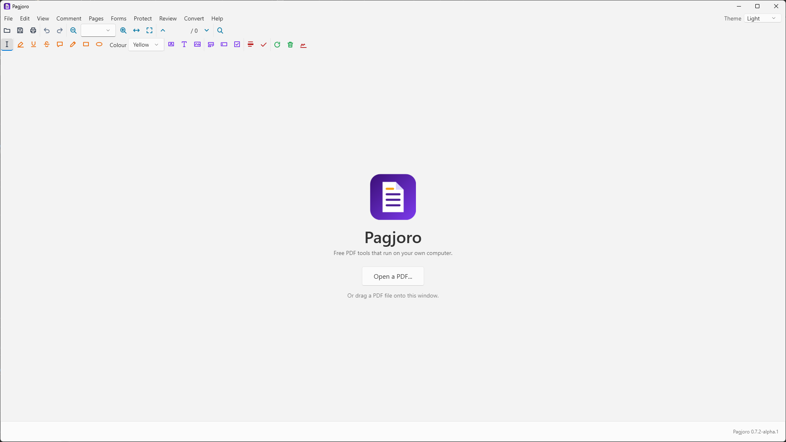
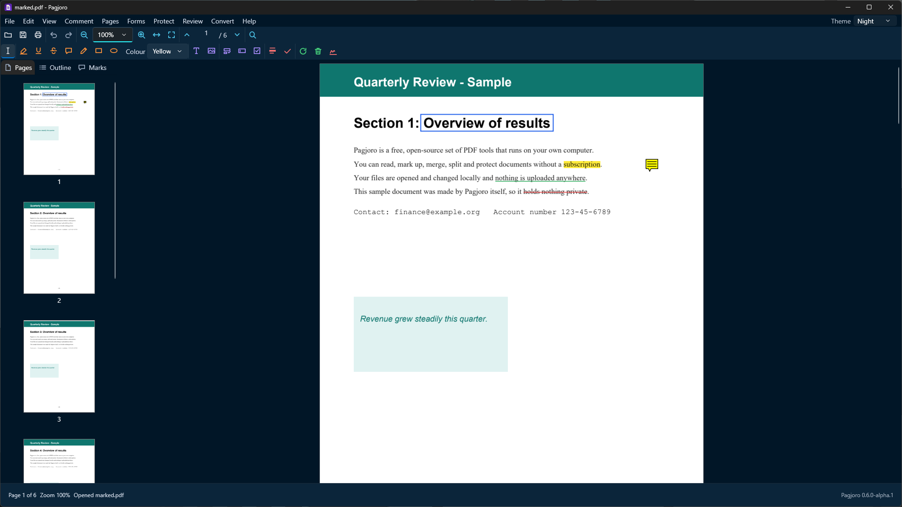
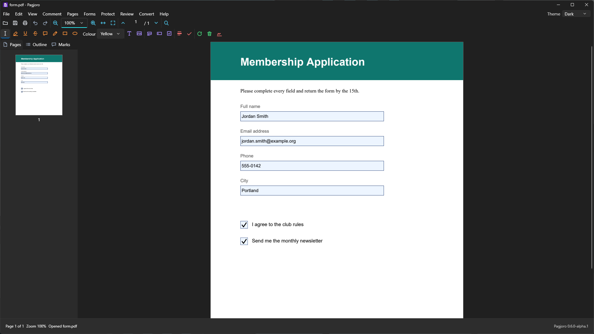
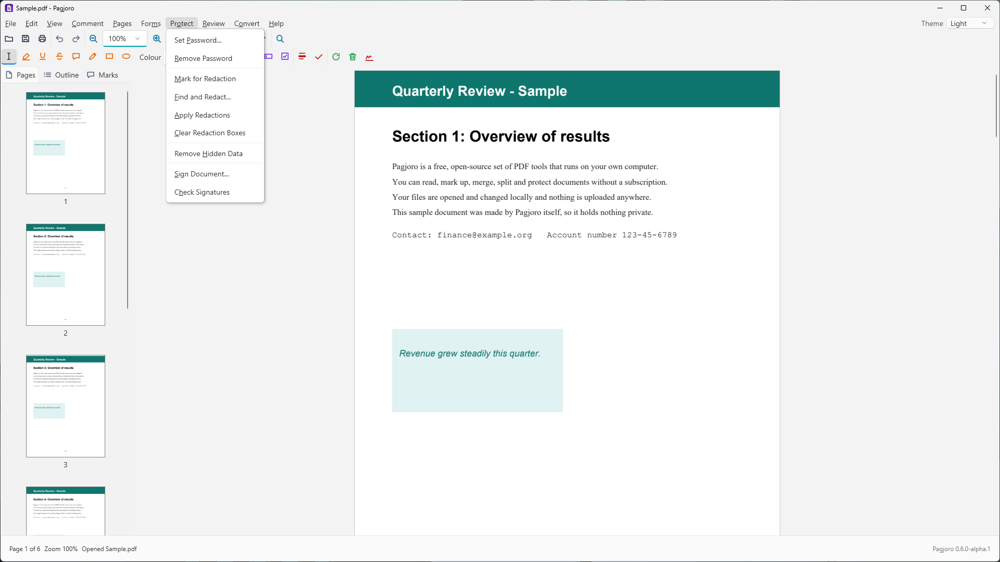

<p align="center"></p>

# Pagjoro

**Free, open-source PDF tools that run on your own computer.** View, annotate, edit, sign, merge, split, convert and protect PDF files, with no subscription, no account and nothing uploaded.

### [Download Pagjoro for Windows](https://github.com/Tusivo/Pagjoro/releases/latest)

On that page, download **Pagjoro.exe** under **Assets** and double-click it. There is no installer. (Early previews are marked *Pre-release*; if the link above says there is no release, open the [releases page](https://github.com/Tusivo/Pagjoro/releases) and choose the newest one.)

> **Status: v0.7.2-alpha.1, an early preview.** Reading, marking up, organizing, forms, protecting, redacting and signing work, and more is on the way (see the [roadmap](#roadmap)). It is **not ready for documents you cannot afford to lose**, so keep a copy of anything you work on.


*The start screen: open a PDF or drag one onto the window. Menus and a toolbar that stays put. (Light theme.)*


*Marking up: highlight, underline, strike through, notes and shapes. (Night theme.)*


*Forms: fill in fields and tick boxes, or add your own. (Dark theme.)*


*Protect: passwords, true redaction, hidden-data removal and digital signatures. (Light theme.)*

## Why Pagjoro

Many people pay a monthly fee just to merge two PDFs or sign a form. Pagjoro is a free program you own:

- **No subscription.** Every feature is included, and always will be.
- **Your files stay yours.** Documents are opened and changed on your own computer. Nothing is sent anywhere unless you choose to send it.
- **Open and checkable.** The source code is public, so anyone can see exactly what the program does with a file.
- **Windows first.** Pagjoro is a native Windows program. Other systems may come later.

## What it covers

Pagjoro aims to cover the everyday and the professional end of PDF work. The full list is in [docs/FEATURE-MAP.md](docs/FEATURE-MAP.md); in short (see the roadmap below for what is working today):

| Area | Examples |
|---|---|
| **Read** | View, zoom, search, bookmarks, thumbnails, print |
| **Organize** | Merge, split, rotate, extract, reorder, insert pages |
| **Annotate** | Highlight, notes, stamps, drawing, comment summary |
| **Forms** | Fill forms, create fields, calculations, import and export data |
| **Edit** | Change text and images, headers, footers, watermarks, page numbers |
| **Protect** | Passwords, permissions, true redaction, remove hidden data |
| **Sign** | Sign with your own certificate, timestamps, validate signatures |
| **Scan and read** | Scan to PDF, recognize text (OCR) in scanned pages |
| **Convert** | Office files to PDF, PDF to images and text, Word, Excel and PowerPoint |
| **Check** | Compare two files, shrink file size, check print and accessibility rules |
| **Automate** | Repeatable action sequences and batch jobs |

## Roadmap

Each phase ends with something you can use.

| Phase | Delivers | State |
|---|---|---|
| 0 | Foundations: solution, policies, build, tests, signing | **Done** |
| 1 | View and read | **Done** |
| 2 | Organize and create | **Done** |
| 3 | Annotate and review | **Done** |
| 4 | Forms | **Done** (fill, add text fields and check boxes) |
| 5 | Edit content | **Done** (change, move and delete text and pictures; add text, pictures, stamps, links, watermarks, headers, footers, numbering) |
| 6 | Protect and redact | **Done** |
| 7 | Sign and certify | **Done** |
| 8 | Scan and OCR | **Done** (text recognition with the engine built into Windows; scanning with the Windows scanner service) |
| 9 | Convert and export | **Done** (images, text, web page, Word, Excel, CSV; Office files and pictures to PDF) |
| 10 | Compare, optimize, check | **Done** (compare, reduce file size, accessibility and print checks) |
| 11 | Automation | **Done** (saved action sequences, batch processing, safety copy of unsaved work) |

## Getting Pagjoro

Download **Pagjoro.exe** from the [releases page](https://github.com/Tusivo/Pagjoro/releases/latest) and run it. There is no installer. Releases are still early previews, so they are marked *Pre-release*. Windows may warn about an unrecognized app the first time, because the program is not code-signed with a Windows certificate yet (choose *More info*, then *Run anyway*).

## Updates and signatures

Every release is signed with a key that is kept offline, not on GitHub, and the matching public key is built into the program. **Check for Updates** (in the window) looks for a newer release only when you press it, and installs a new version only if its signature verifies, so a tampered download is refused. Your current copy is kept as a backup in the same folder. Releases without a signature file are never offered. See [docs/RELEASING.md](docs/RELEASING.md).

## Building from source

You need Windows 10 or 11 and the [.NET 10 SDK](https://dotnet.microsoft.com/download).

```bash
git clone https://github.com/Tusivo/Pagjoro.git
cd Pagjoro
dotnet test
powershell -ExecutionPolicy Bypass -File scripts\build.ps1   # builds dist\Pagjoro.exe
```

The solution has three projects: `src/Pagjoro.Core` (the program's logic, no user interface), `src/Pagjoro.App` (the Windows application) and `tests/Pagjoro.Tests`. See [docs/ARCHITECTURE.md](docs/ARCHITECTURE.md).

## Documents

- [docs/FEATURE-MAP.md](docs/FEATURE-MAP.md): what is planned, and what is done
- [docs/ARCHITECTURE.md](docs/ARCHITECTURE.md): how the program is put together
- [LEGAL.md](LEGAL.md): the project's clean-room and trademark policy
- [SECURITY.md](SECURITY.md): the security model, and how to report a vulnerability
- [THIRD-PARTY-NOTICES.md](THIRD-PARTY-NOTICES.md): the open-source components Pagjoro uses and their licenses
- [docs/RELEASING.md](docs/RELEASING.md): how a release is made and signed

## Contributing and support

- **Found a problem?** Open an [issue](https://github.com/Tusivo/Pagjoro/issues). Issues are public, so never attach private documents; describe the problem or use a sample file made for the purpose.
- **A feature idea?** Open an issue, or write to [info@tusivo.com](mailto:info@tusivo.com).
- **Contributing code?** Please read [LEGAL.md](LEGAL.md) first. In short: work from public specifications, never from another company's confidential or restricted material, and keep all names, wording and artwork original.

## Support the project

Pagjoro is free and made by one person. If it is useful to you, you can [buy me a coffee](https://buymeacoffee.com/tusivo). Donations change nothing about the program: every feature is there for everyone.

## License

Pagjoro is licensed under the **GNU Affero General Public License 3.0 or later** (AGPL-3.0-or-later). See [LICENSE](LICENSE).

Pagjoro is a [Tusivo](https://tusivo.com) project. Adobe and Acrobat are trademarks of Adobe Inc. Pagjoro is not affiliated with, endorsed by or sponsored by Adobe; the names appear here only to describe what Pagjoro is an alternative to. "PDF" is the name of an open ISO standard (ISO 32000).
